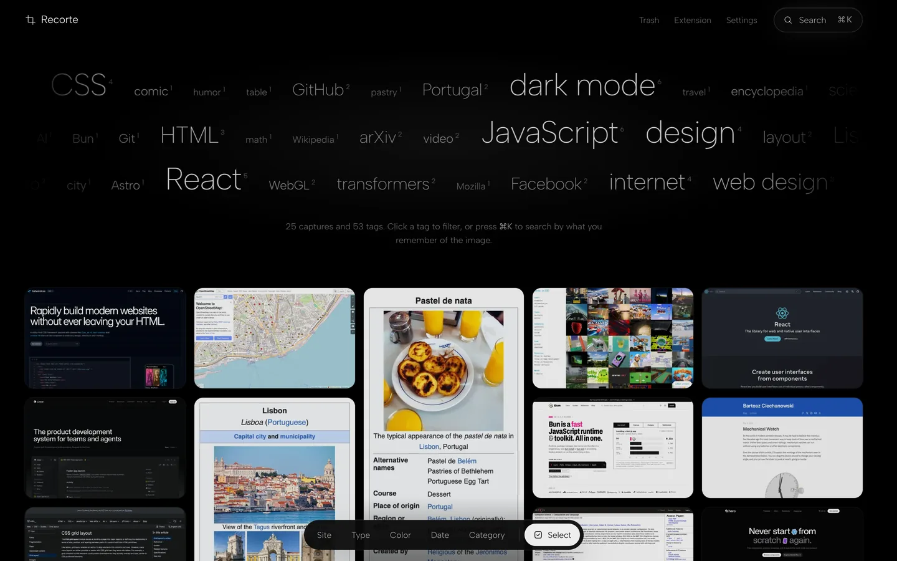
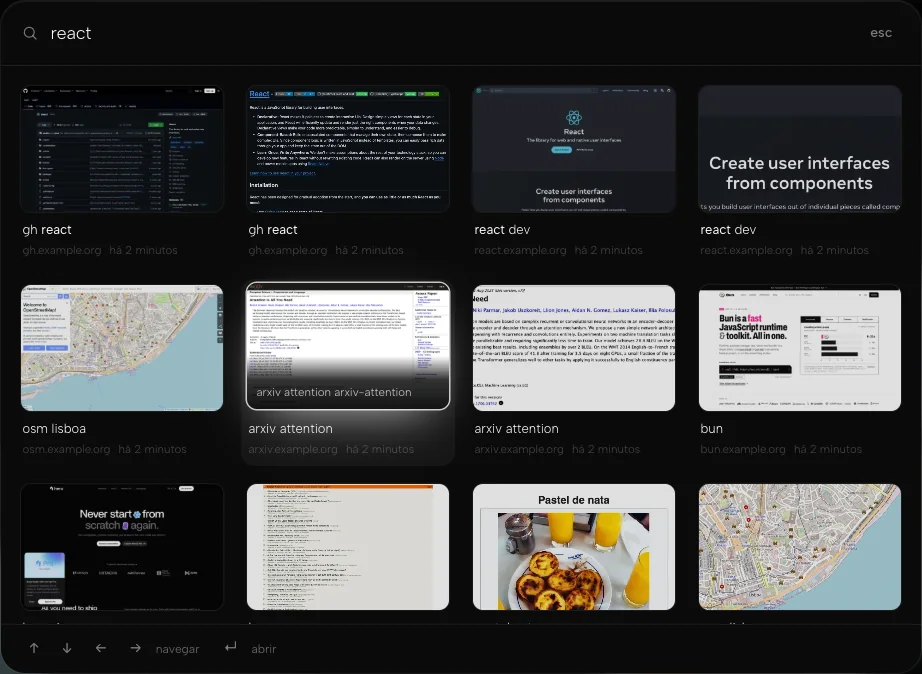
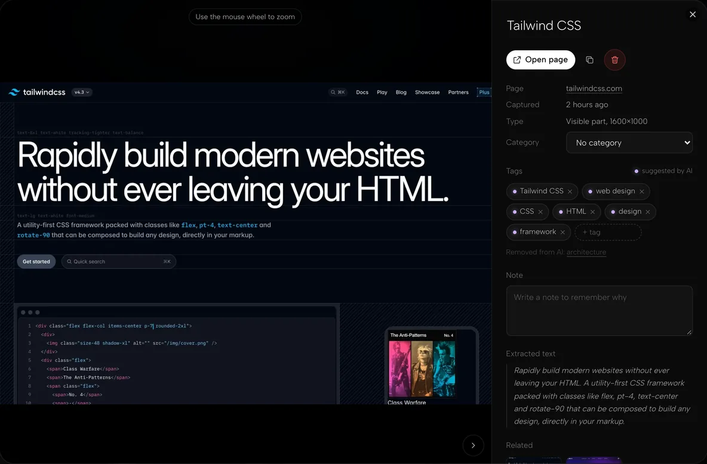
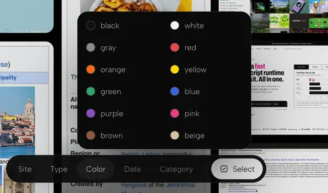
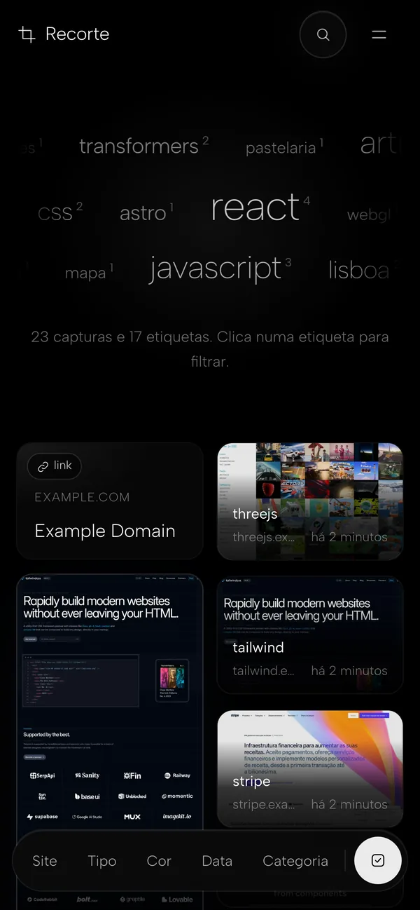

<p align="center">
  
</p>

<h1 align="center">Recorte</h1>

<p align="center">
  <strong>Find what you saw.</strong><br>
  Screenshots and links from the web, saved to your own server, tagged by local AI, searchable by what you remember.
</p>

<p align="center">
  <a href="https://qwickin.github.io/recorte/">Website</a> ·
  <a href="#quick-start">Quick start</a> ·
  <a href="#install-the-extension">Extension</a> ·
  <a href="https://x.com/qwickin">@qwickin</a> ·
  <a href="LICENSE">MIT</a>
</p>

<p align="center">
  
</p>

You screenshot things to remember them, and then you never find them again. Recorte is a browser extension plus a small self-hosted server that fixes that.
- Each capture keeps the address and the text of the page it came from.
- A local AI tags each capture, with no cloud required.
- Everything lands in a fast, black, minimal gallery.
- Search by describing what you remember. "Portuguese custard tarts" finds the pastel de nata page even if it was written in English.

It runs as **one Docker container**. Your captures stay on your disk.

## Features

- **Capture in one keystroke.** Capture an area, the visible part or the full page. You can add a title, note, tags and a category before it saves.
- **Save links, pages and images.** Use the right-click menu. The server fetches the title, description and preview image. A post from X with a video keeps its embedded player.
- **Local AI tagging.** Tagging runs on the CPU, with no GPU and no API key:
  - a text tagger reads the whole page;
  - SigLIP2 looks at the screenshot for page type, visual style and colors.
  - A cloud LLM (any OpenAI-compatible API) is optional and off by default.
- **Hybrid search.** ⌘K / Ctrl+K combines full-text and semantic search, using an embedded Meilisearch with a multilingual embedding model. Results come back as images.
- **The gallery:**
  - masonry with infinite scroll;
  - a tag cloud that scrolls by and filters on click;
  - a floating filter Dock (site, type, color, date, category);
  - multi-select for bulk actions;
  - a zoomable detail view;
  - a trash with 30-day restore.
- **Phone-friendly.** The gallery is responsive and installs as a PWA.
- **Private by design.**
  - One owner account (email + password). Each extension connects with its own revocable device token.
  - Images are only served to a signed-in session.
- **Plain files.**
  - One `meta.json` per capture, next to its images, plus SQLite.
  - Export everything as a ZIP. The search index can always be rebuilt from the files.
- **Offline-safe extension.** If the server is down, captures wait in a local queue and upload later.
- **Five languages.** English, Português (Brasil), Español, Français and Italiano.

| | |
|---|---|
|  |  |
|  |  |

> The screenshots show the earlier Portuguese interface; the UI is now English by default.

## How it works

```
 browser extension                       your server: one container (port 8080)
 ┌────────────────────────────┐          ┌──────────────────────────────────────────────┐
 │ capture → crop → page text │  HTTPS   │ API (Node 24 + Hono)  →  /data/items/…/       │
 │ → pre-save dialog          │ ───────► │   meta.json + images + SQLite                 │
 │ → offline queue (IndexedDB)│  device  │ worker: thumbnails, colors, text tagger,      │
 └────────────────────────────┘  token   │   SigLIP2 vision, [optional cloud LLM]        │
                                         │ embedded Meilisearch (127.0.0.1 only)         │
 gallery (React + HeroUI, PWA)  ◄──────  │ serves the gallery and the extension ZIPs     │
                                         └──────────────────────────────────────────────┘
```

1. The extension captures the page and extracts its text from the DOM. It then shows a short dialog and uploads the capture with the page URL.
2. The server writes the files and a `meta.json`, which is the source of truth, and adds a row to SQLite. The capture shows up in the gallery at once, over server-sent events.
3. A background worker processes the capture:
   - it makes thumbnails and extracts colors;
   - it runs the text tagger and the SigLIP2 classifier;
   - it optionally calls your cloud model;
   - it indexes everything in Meilisearch.
4. Search is hybrid: keyword plus semantic, with the `paraphrase-multilingual-MiniLM-L12-v2` embedder. It works across languages.

The full design is in [`docs/superpowers/specs/2026-11-07-recorte-design.md`](docs/superpowers/specs/2026-11-07-recorte-design.md). That document is written in Portuguese.

## Requirements

- Docker on amd64 or arm64.
- **2 GB of RAM minimum, 4 GB recommended.** The container uses about 1.5–2 GB: the app about 0.6 GB, Meilisearch about 1 GB.
- **Internet access on the first start.** Meilisearch downloads its embedding model then (`paraphrase-multilingual-MiniLM-L12-v2`, about 450 MB, kept in the volume). The vision model ships inside the image.

## Quick start

```sh
docker run -d --name recorte --restart unless-stopped -p 8080:8080 -v recorte:/data ghcr.io/qwickin/recorte
```

No `.env`, no configuration. Then:

1. Open `http://<server-ip>:8080`. The setup wizard (`/setup`) has three steps:
   1. **Account.** Your email and a password. They are used by both the gallery and the extension. The email is only a username: the server never sends email.
   2. **Server.** Confirm the public address. It is pre-filled with the address you typed. You can also connect an optional OpenAI-compatible cloud AI (URL, key, model). With cloud AI on, a reduced copy of each capture and its text go to that third party.
   3. **Extension.** Download the ZIP for Chrome or Firefox and follow the steps.
2. **The wizard only stays open for 15 minutes after the container starts**, and only while no account exists. `docker logs recorte` prints the setup link. If the time runs out, run `docker restart recorte` and open `/setup` again.

Everything lives in the `recorte` volume (`/data` in the container). You can change the public address and the cloud AI later in **Settings → Server**.

- **Different port:** `-p 9000:8080`.
- **Host folder instead of a volume:** `-v /srv/recorte:/data`. On Linux, run `sudo chown 1000:1000 /srv/recorte` first, because the app runs as uid 1000.

### With Docker Compose

```sh
git clone https://github.com/qwickin/recorte.git
cd recorte/docker
mkdir -p data && sudo chown 1000:1000 data   # chown only on Linux
docker compose up -d                         # published image
../scripts/up.sh                             # or: build from this checkout, with Git versions
```

`compose.yml` has a single service (`app`) and keeps everything in `docker/data`. A `.env` file is optional; `.env.example` lists every setting, all commented out.

`scripts/up.sh` (or `pnpm stack:up` from the root) computes the versions with `scripts/version.mjs` and passes them to the build. A plain `docker compose up -d --build` stamps version `0.0.0`, and then the extension's "new version available" notice never appears.

## Install the extension

Download the extensions from your own gallery: open the **Extension** page while signed in. The ZIPs always match the server's version.

**Chrome, Edge, Brave and other Chromium browsers**
1. Download the Chrome ZIP and unzip it into a folder you will keep.
2. Open `chrome://extensions` and turn on **Developer mode**.
3. Click **Load unpacked** and pick the folder.
4. In the extension's options, enter:
   - the server's public URL, e.g. `http://192.168.1.20:8080`;
   - your email and password;
   - optionally, a device name.

   The password is not stored: it is exchanged for a device token.

**Firefox**
- Firefox only loads unsigned extensions as **temporary add-ons**:
  1. Open `about:debugging#/runtime/this-firefox`.
  2. Click **Load Temporary Add-on…** and pick the ZIP.

  The add-on is removed when Firefox restarts.
- For a permanent install, use **Firefox Developer Edition** or **Nightly**:
  1. Set `xpinstall.signatures.required` to `false` in `about:config`.
  2. Install the ZIP from `about:addons` → ⚙ → **Install Add-on From File…**.

Browsers don't auto-update these extensions. When the server ships a new version, the extension shows a notice; download the new ZIP and load it again.

### Keyboard shortcuts

| Action | macOS | Windows / Linux |
|---|---|---|
| Capture an area | ⌃⇧S (Control+Shift+S) | Alt+Shift+S |
| Capture the visible part | ⌃⇧V (Control+Shift+V) | Alt+Shift+V |
| Capture the full page | ⌃⇧F (Control+Shift+F) | Alt+Shift+F |

On macOS the shortcuts use Control, because ⌘⇧ combinations clash with system screenshots and browser shortcuts. You can remap them at `chrome://extensions/shortcuts`, or in Firefox at `about:addons` → ⚙ → **Manage Extension Shortcuts**.

The right-click menu adds three more actions: save an image, save a link, and save the current page as a link.

## HTTPS with your own domain (Caddy)

Sessions work over plain `http://<IP>:8080`; the cookie is only marked `Secure` over HTTPS. To use a domain with HTTPS, the `compose.caddy.yml` override adds Caddy, which obtains and renews a Let's Encrypt certificate.

1. Point the domain's DNS (A/AAAA records) at the server, and open ports 80 and 443.
2. In `docker/.env`, set `DOMAIN=recorte.example.com`. `PUBLIC_URL` then becomes `https://$DOMAIN` automatically.
3. Start the stack. This needs Compose **2.24 or newer**, for `!reset`:

   ```sh
   ../scripts/up.sh --caddy                              # from the checkout
   docker compose -f compose.yml -f compose.caddy.yml up -d   # or with the published image
   ```

With this override, port 8080 is no longer published; only Caddy (80/443) is exposed.

**Other reverse proxies** must:
- pass `X-Forwarded-Proto` and `Host`/`X-Forwarded-Host`;
- not buffer `/api/events`, which uses server-sent events.

Set the public address in **Settings → Server** (or with `PUBLIC_URL`).

### Install the gallery as an app (PWA)

- **Android (Chrome):** use **Install app**.
- **iOS (Safari):** use **Share → Add to Home Screen**.

Browsers only allow installing, and only run the service worker, over **HTTPS** or on `http://localhost`. On `http://<IP>:8080` the gallery still works, but it can't be installed. The service worker caches only the app shell and static files. Captures and API calls always come from the server.

## Configuration

Everything is optional. You can set each of these from the gallery instead. When an environment variable is set, it wins, and the matching field in Settings is locked.

| Variable | What it does |
|---|---|
| `PUBLIC_URL` | The public address, exactly as typed in the browser, with no trailing slash. |
| `AI_CLOUD_URL`, `AI_CLOUD_KEY`, `AI_CLOUD_MODEL` | Optional OpenAI-compatible cloud AI for titles and descriptions. Images are sent to that third party. |
| `ADMIN_EMAIL`, `ADMIN_PASSWORD` | Set both to create the owner account at first start, without the wizard. Remove `ADMIN_PASSWORD` afterwards: it is no longer used, and leaving it set keeps it in plain text. |
| `MEILI_URL`, `MEILI_MASTER_KEY` | Use an external Meilisearch (see below). Without `MEILI_URL`, the app starts its embedded one. |

These are compose-only (`docker/.env`):

| Variable | What it does |
|---|---|
| `RECORTE_PORT` | Host port for the app (default `8080`). Ignored with `compose.caddy.yml`. |
| `DOMAIN` | Your domain, for `compose.caddy.yml`. |
| `RECORTE_IMAGE` | The image to run (default `ghcr.io/qwickin/recorte:latest`). |
| `APP_VERSION`, `EXTENSION_VERSION` | Only for `docker compose build`; `scripts/up.sh` sets them for you. |

### Advanced: Meilisearch as a separate service

By default, the embedded Meilisearch:
- listens only on `127.0.0.1:7700` inside the container;
- keeps its data in `/data/meili`;
- uses a master key generated at first start in `/data/secrets/meili.key` (mode 0600).

To run it on its own, set `MEILI_MASTER_KEY` (at least 16 characters, e.g. `openssl rand -base64 32`) in `docker/.env` and use the override:

```sh
docker compose -f compose.yml -f compose.meili-external.yml up -d
```

With `MEILI_URL` set, the app doesn't start the embedded Meilisearch.

## Reset the password

The server doesn't send email, so you reset the password on the server itself:

```sh
docker exec recorte recorte reset-password you@example.com                        # generates and prints a new one
docker exec recorte recorte reset-password you@example.com --password '<new>'    # or set it yourself
# with compose: docker compose exec app recorte reset-password …
```

Resetting the password ends every session and disconnects every extension. Each extension has to sign in again.

## Backup

- **Everything is in `/data`**: the `recorte` volume, or `docker/data` with compose. It holds:
  - the images and one `meta.json` per capture;
  - the SQLite database (`recorte.db`, which includes your settings);
  - `secrets/`;
  - the Meilisearch index (`meili/`).
- **Copy it with the app stopped** (`docker stop recorte`), for example:

  ```sh
  docker run --rm -v recorte:/data -v "$PWD":/backup alpine tar czf /backup/recorte.tgz -C /data .
  ```
- The gallery can also export every capture as a ZIP: **Settings → Export**.
- **`/data/meili` doesn't need backing up.** The search index is rebuilt from the `meta.json` files with **Settings → Rebuild index**. For a rebuild from scratch:
  1. stop the container;
  2. delete `/data/meili`;
  3. start the container;
  4. rebuild the index.

## Update

```sh
docker pull ghcr.io/qwickin/recorte
docker stop recorte && docker rm recorte     # clean stop (SQLite and Meilisearch); data stays in the volume
docker run -d --name recorte --restart unless-stopped -p 8080:8080 -v recorte:/data ghcr.io/qwickin/recorte

git pull && ../scripts/up.sh                 # compose, from the checkout
docker compose pull && docker compose up -d  # compose, with the published image
```

**The image has moved.** It used to be published as `ghcr.io/qwickin/screenshotextension`. GHCR doesn't redirect renamed packages, so:
- replace that name in your `docker run` command;
- update `RECORTE_IMAGE` in `docker/.env` if you set it.

**Upgrading from the two-service version (`app` + `search`):**
- **Account.** Your account keeps the same email and password. `SETUP_TOKEN` no longer exists.
- **Accounts created by the password-only version.** The first successful login sets the email you enter. You can also run `recorte reset-password <email>`.
- **Search index.** Meilisearch now runs inside the container, with a fresh index in `docker/data/meili`. After updating, click **Settings → Rebuild index** once.
- **The old `search` service.** On the first update, remove it, or it keeps running on its own:
  - plain compose: `docker compose up -d --remove-orphans`;
  - with Caddy: `docker compose -f compose.yml -f compose.caddy.yml up -d --remove-orphans`.

  You can delete the old `docker/meili` folder.
- **Extensions** only need to sign in again if the password changed.

## Privacy

- **Your data stays on your server.** Captures, page text, tags and search all live in `/data`. There is no telemetry, and the embedded Meilisearch runs with analytics off.
- **Local AI by default.** The text tagger, SigLIP2 and the embedding model all run inside the container. Nothing is sent out unless you turn on cloud AI. If you do, a reduced image and the page text of each capture go to the provider you chose.
- **Saved links.** When you save a link, your server fetches that URL to read its title and preview. The fetch is guarded against SSRF: it only reaches public addresses, with size and time limits.
- **Access control.**
  - The gallery and images are only served to a signed-in session.
  - Extensions use per-device tokens that you can revoke.
  - Passwords are hashed with argon2id.

## Languages

The gallery and the extension are available in **English** (default), **Português (Brasil)**, **Español**, **Français** and **Italiano**.
- **Gallery:** follows your browser's language. You can change it in **Settings**, and also on the sign-in and setup pages.
- **Extension:** follows the browser's language. You can change it in its options.
- **AI tags:** stored as language-neutral IDs, so each viewer sees them in their own language. Search finds them in any of the five.

## Development

You need Node 24 and pnpm 12, plus Git with full history, because versions are derived from it.

```sh
pnpm install --frozen-lockfile
pnpm typecheck
pnpm test                                   # unit tests of every package + scripts/
pnpm build                                  # gallery (apps/gallery/dist) + extension (apps/extension/.output)
pnpm --filter @recorte/extension zip        # recorte-chrome.zip and recorte-firefox.zip
pnpm --filter @recorte/server dev           # server on :8080 (without MEILI_URL or MEILI_BIN, search is off)
pnpm --filter @recorte/gallery dev          # gallery with a proxy to the server
pnpm --filter @recorte/extension dev        # extension in development mode (WXT)
pnpm --filter @recorte/e2e e2e              # E2E: the real image (docker run) + Chromium
```

The E2E test:
- builds the image and runs it like the `docker run` above, with no configuration, on a free port and its own volume;
- completes `/setup` with an email and password;
- removes the container and the volume at the end.

It uses Chromium from the Playwright cache, or the path in `CHROMIUM_PATH`.

| Folder | What |
|---|---|
| `apps/server` | Node 24 + Hono: API, worker, SQLite |
| `apps/gallery` | Vite + React 19 + HeroUI + Tailwind 4 |
| `apps/extension` | WXT (Chrome MV3, Firefox MV2) |
| `packages/shared` | API contract (Zod), i18n helpers |
| `packages/ai` | SigLIP2 classifier, text tagger, vocabulary, labels |
| `docker/` | Dockerfile (with embedded Meilisearch), compose files, Caddy |
| `scripts/` | `version.mjs`, `up.sh` |
| `e2e/` | end-to-end test |
| `site/` | the landing page (GitHub Pages) |

## Versioning and CI

Versions come from Git (`scripts/version.mjs`):

- **App** (server and gallery): `MAJOR.MINOR.<commits since the tag>`.
- **Extension:** `MAJOR.MINOR.<commits since the tag that touch apps/extension or packages/shared>`. The "new version" notice only appears when the extension actually changed.
- `MAJOR.MINOR` comes from the latest `vX.Y` tag. With no tags, the version is `0.0.<number of commits>`.
- Versions are integers only, with no hash and no `-dirty` suffix, because Chrome accepts nothing else.

```sh
node scripts/version.mjs        # {"app":"0.1.12","extension":"0.1.3"}
git tag v0.2 && git push --tags # starts the 0.2.x series
```

**CI** (`.github/workflows/ci.yml`) typechecks, tests and builds everything, and produces the extension ZIPs, on every push and pull request.
- Only CI publishes the image, on pushes to `main` and on `v*` tags. Creating a tag locally publishes nothing.
- The image is multi-arch (amd64 and arm64). It goes to `ghcr.io/qwickin/recorte`, tagged with the app version and `latest`.
- Actions are pinned by SHA, and Dependabot (`.github/dependabot.yml`) proposes updates weekly.

`.github/workflows/pages.yml` deploys the landing page in `site/` to GitHub Pages.

To build locally with the right versions:

```sh
docker build -f docker/Dockerfile \
  --build-arg APP_VERSION=$(node scripts/version.mjs --app) \
  --build-arg EXTENSION_VERSION=$(node scripts/version.mjs --extension) \
  -t recorte .
```

## Known limitations

- **Extensions:** Chrome requires Developer mode. On stable Firefox, the extension is only temporary.
- **Capture:** area selection is limited to the visible screen, and full-page captures are capped at 12,000 px tall.
- **Search:** with the local embedder, Meilisearch recommends a cloud embedder above roughly 10,000 frequently updated documents. That is plenty for personal use.

## License

[MIT](LICENSE) © 2026 qwickin.

Albert Sans (used by the gallery and the website) is licensed under the SIL Open Font License.

---

<p align="center">
  <a href="https://qwickin.github.io/recorte/">qwickin.github.io/recorte</a> ·
  <a href="https://github.com/qwickin/recorte">GitHub</a> ·
  <a href="https://x.com/qwickin">X @qwickin</a>
</p>
